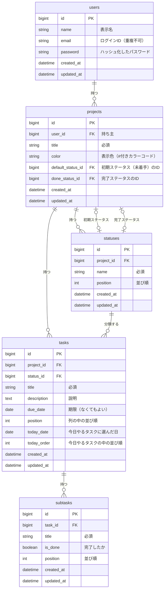

# TaskBoard データベース設計

[要件定義書](requirements.md) のデータに関する詳細をまとめる。

## 1. ER図

## 2. テーブル定義

型は PostgreSQL を想定して書く（データベースは最終決定ではない。[技術スタック](tech-stack.md) を参照）。自動採番は `GENERATED ALWAYS AS IDENTITY` で作る。PostgreSQL には、更新時に日時を自動で変える機能（MySQL の `ON UPDATE`）がないので、`updated_at` をトリガーで変えるかアプリで入れるかは、設計で決める。削除したときの動き（4章）を、データベースの連鎖削除で実現するかアプリで実現するかは、設計で決める。

### users（ユーザー）

| カラム | 型 | 必須 | 初期値 | 制約・説明 |
|---|---|---|---|---|
| id | BIGINT | ○ | 自動採番（IDENTITY） | 主キー |
| name | VARCHAR(20) | ○ | | 表示名 |
| email | VARCHAR(255) | ○ | | ログインID。重複不可 |
| password | VARCHAR(255) | ○ | | ハッシュ化したパスワード |
| created_at | TIMESTAMP | ○ | 現在日時 | |
| updated_at | TIMESTAMP | ○ | 現在日時 | 更新時に現在日時へ変える |

### projects（プロジェクト）

| カラム | 型 | 必須 | 初期値 | 制約・説明 |
|---|---|---|---|---|
| id | BIGINT | ○ | 自動採番（IDENTITY） | 主キー |
| user_id | BIGINT | ○ | | 外部キー → users.id。持ち主 |
| title | VARCHAR(30) | ○ | | |
| color | CHAR(7) | ○ | 基本カラーの1つ | `#` ＋ 16進数6桁 |
| default_status_id | BIGINT | | なし（空） | 初期ステータス（未着手）。（id, default_status_id）で statuses（project_id, id）を参照する複合外部キー。ステータスを作った直後に記録する |
| done_status_id | BIGINT | | なし（空） | 完了ステータス。（id, done_status_id）で statuses（project_id, id）を参照する複合外部キー。ステータスを作った直後に記録する |
| created_at | TIMESTAMP | ○ | 現在日時 | |
| updated_at | TIMESTAMP | ○ | 現在日時 | 更新時に現在日時へ変える |

### statuses（ステータス）

| カラム | 型 | 必須 | 初期値 | 制約・説明 |
|---|---|---|---|---|
| id | BIGINT | ○ | 自動採番（IDENTITY） | 主キー |
| project_id | BIGINT | ○ | | 外部キー → projects.id |
| name | VARCHAR(20) | ○ | | |
| position | INT | ○ | | 並び順 |
| created_at | TIMESTAMP | ○ | 現在日時 | |
| updated_at | TIMESTAMP | ○ | 現在日時 | 更新時に現在日時へ変える |

制約：（project_id, id）の組を一意にする（tasks の複合外部キーで使う）

### tasks（タスク）

| カラム | 型 | 必須 | 初期値 | 制約・説明 |
|---|---|---|---|---|
| id | BIGINT | ○ | 自動採番（IDENTITY） | 主キー |
| project_id | BIGINT | ○ | | 外部キー → projects.id |
| status_id | BIGINT | ○ | | （project_id, status_id）で statuses（project_id, id）を参照する複合外部キー |
| title | VARCHAR(50) | ○ | | |
| description | VARCHAR(1000) | | なし | 説明 |
| due_date | DATE | | なし | 期限 |
| position | INT | ○ | | 列の中の並び順 |
| today_date | DATE | | なし | 今日やるタスクに選んだ日（朝4時の区切りで判断した日付） |
| today_order | INT | | なし | 今日やるタスクの中の並び順。選んだときに、そのときの最大値＋1を入れる |
| created_at | TIMESTAMP | ○ | 現在日時 | |
| updated_at | TIMESTAMP | ○ | 現在日時 | 更新時に現在日時へ変える |

### subtasks（サブタスク）

| カラム | 型 | 必須 | 初期値 | 制約・説明 |
|---|---|---|---|---|
| id | BIGINT | ○ | 自動採番（IDENTITY） | 主キー |
| task_id | BIGINT | ○ | | 外部キー → tasks.id |
| title | VARCHAR(50) | ○ | | |
| is_done | BOOLEAN | ○ | false | 完了したか |
| position | INT | ○ | | 並び順 |
| created_at | TIMESTAMP | ○ | 現在日時 | |
| updated_at | TIMESTAMP | ○ | 現在日時 | 更新時に現在日時へ変える |

## 3. インデックス

よく使う検索と並べ替えを速くするために、次のインデックスを付ける。データを追加・更新するたびにインデックスも更新されるので、よく使う検索に絞って付ける。

| インデックス名 | テーブル | カラム | 種類 | 使う場面 |
|---|---|---|---|---|
| PRIMARY | 全テーブル | id | 主キー | IDで1件を取り出す |
| uk_users_email | users | email | 一意 | ログインのとき、メールアドレスでユーザーを探す。同じメールアドレスの登録を防ぐ |
| idx_projects_user_created | projects | user_id, created_at | 通常 | サイドメニューに、ユーザーのプロジェクトを作成した順に並べる |
| uk_statuses_project_id | statuses | project_id, id | 一意 | tasks と projects の複合外部キーの参照先にする（4章の整合性） |
| idx_statuses_project_position | statuses | project_id, position | 通常 | ボードの列と、プロジェクト設定のステータスを並び順に出す |
| idx_tasks_project_status_position | tasks | project_id, status_id, position | 通常 | ボードで、列ごとのタスクを並び順に出す。複合外部キーの確認にも使う |
| idx_tasks_project_due | tasks | project_id, due_date | 通常 | カレンダーで、その月に期限があるタスクを出す |
| idx_tasks_today | tasks | today_date, today_order | 通常 | ダッシュボードで、今日やるタスクを並び順に出す |
| idx_subtasks_task_position | subtasks | task_id, position | 通常 | タスク詳細で、サブタスクを並び順に出す |

- PostgreSQL は、外部キーのカラムにインデックスを自動では付けない。外部キーのカラムは、どれも上の表のインデックスの先頭にある（projects の複合外部キーは主キーの id が先頭）ので、外部キー用のインデックスは別に足さない
- ダッシュボードのタスク一覧（全プロジェクトの、完了以外のタスクを期限が近い順）は、1人分のデータ量なら上のインデックスで十分速い。遅くなったときに、追加を検討する

## 4. 制約

| 対象 | 決めごと |
|---|---|
| 初期・完了ステータス | プロジェクトを作ると、ステータスを4つ（未着手 / 進行中 / 確認中 / 完了）自動で作る。「未着手」のIDを `projects.default_status_id` に、「完了」のIDを `projects.done_status_id` に記録する |
| 初期・完了ステータス | `default_status_id` と `done_status_id` は、プロジェクトを作った時点ではまだ空にしておき、4つのステータスを作った直後に記録する |
| 初期・完了ステータス | 初期か完了かはIDで判断するので、名前を変えても影響しない。初期ステータスと完了ステータスは削除できない。タスクを作るときのステータスの初期値は、初期ステータス |
| 整合性 | タスクのステータスは、同じプロジェクトのステータスに限る。保存するときにアプリ側で確認し、さらにデータベースでも `project_id` と `status_id` のセットで確認する（複合外部キー） |
| 整合性 | プロジェクトの `default_status_id` と `done_status_id` も、そのプロジェクトのステータスに限る。アプリ側で確認し、データベースでも `id` とそれぞれのIDのセットで確認する（複合外部キー） |
| 日付の区切り | 日時は日本時間（Asia/Tokyo）で扱う。「今日」は朝4時に切り替わる（0時〜3時59分は前の日として扱う）。今日やるタスクと期限アラートの両方で、この区切りを使う |
| 今日やるタスク | 選んだ日を `tasks.today_date` に記録し、`tasks.today_order` に今日やるタスクの最大値＋1を入れる（選んだ順になる）。`today_date` が「今日」と同じタスクだけを、`today_order` の小さい順に表示する。日付が変わると、自動で外れる |
| 今日やるタスク | タスクを完了ステータスにしたときは、`today_date` と `today_order` を空にする。あとで未完了に戻しても、今日やるタスクには戻らない |
| 今日やるタスク | 今日やるタスクから外すときも、`today_date` と `today_order` を空にする |
| 今日やるタスク | 並び順を番号で持つのは、将来、今日やるタスクの中で並べ替える機能を足せるようにするため（[要件定義書](requirements.md) の8章「将来の拡張候補」） |
| プロジェクトの色 | 基本カラー（赤・オレンジ・黄・緑・青・紫・ピンク・グレーの8色）から選ぶか、#付きのカラーコード（例：`#3B82F6`）で指定する。作成時は基本カラーの1つが自動で設定される |
| 基本カラー | 基本カラーのカラーコードは、赤 `#EF4444`、オレンジ `#F97316`、黄 `#EAB308`、緑 `#22C55E`、青 `#3B82F6`、紫 `#A855F7`、ピンク `#EC4899`、グレー `#6B7280` |
| サブタスクの数 | カードとタスク詳細に出す「完了した数 / 全体の数」は保存せず、表示するときに subtasks から数える（数を別のカラムに持つと、サブタスクを変えるたびに更新が必要になり、ずれる原因になるため） |
| 削除 | プロジェクトを削除すると、その中のステータス・タスク・サブタスクもまとめて削除する。タスクを削除すると、そのサブタスクもまとめて削除する |
| 削除の順番 | projects と statuses はお互いを参照しているので、プロジェクトを削除するときは、先に `default_status_id` と `done_status_id` を空にしてから、サブタスク → タスク → ステータス → プロジェクトの順に消す |
| データの範囲 | ユーザーは、自分の `user_id` を持つプロジェクトと、その中のデータだけを扱える |
