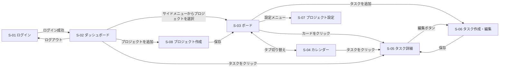

# TaskBoard 画面設計

[要件定義書](requirements.md) の画面に関する詳細をまとめる。

## 1. 画面一覧

| ID | 画面 | 主な内容 |
|---|---|---|
| S-01 | ログイン | メールアドレスとパスワードを入力する。アカウントは初期データで用意する |
| S-02 | ダッシュボード | 左に今日やるタスク、右にタスク一覧を表示する。ログイン後に最初に開く画面 |
| S-03 | プロジェクト画面（ボード） | ステータスの列とカード。ドラッグ＆ドロップで移動できる。デフォルトのタブ |
| S-04 | プロジェクト画面（カレンダー） | 月表示で、期限日の位置にタスクを表示する（優先度：中） |
| S-05 | タスク詳細 | タスクの表示と、サブタスクの操作（ダイアログ） |
| S-06 | タスク作成・編集 | タイトル・説明・期限・ステータスの入力と編集（ダイアログ） |
| S-07 | プロジェクト設定 | プロジェクトの名前・色の変更、削除と、ステータスの管理 |
| S-08 | プロジェクト作成 | プロジェクトのタイトルの入力（ダイアログ） |

すべての画面に、サイドメニュー（ダッシュボード / プロジェクト一覧）を共通で置く。スマホでは、サイドメニューをボタンで開閉する。

## 2. ワイヤーフレーム

ワイヤーフレームは、HTML・CSS・JavaScript でモックアップを作るときの元にする。例のデータは、今日を 2026年11月2日として描いている。

共通の決めごと：
- カレンダーのマスやボードのカードのように狭い場所では、長いタイトルを省略して表示する（例：「レポート..」）。タスク詳細では全部表示する
- `[ ]` で囲んだ文字はボタンや入力欄、`【赤】` `【黄】` は期限アラートの色を表す

### S-01 ログイン

```
+--------------------------------------+
| TaskBoard                            |
|                                      |
| メールアドレス                       |
| [ yamada@example.com            ]    |
| パスワード                           |
| [ ********                      ]    |
|                                      |
| メールアドレスまたはパスワードが     |
| 正しくありません                     |
|                                      |
|                           [ログイン] |
+--------------------------------------+
```

- 画面の中央に表示し、サイドメニューは出さない
- エラーメッセージは、ログインに失敗したときだけ出す（UC-01）

### S-02 ダッシュボード（PC）

```
+----------------------------------------------------------------------------------+
| TaskBoard                                                              山田 太郎 |
+----------------------+-----------------------------+-----------------------------+
| > ダッシュボード     | 今日やるタスク              | タスク一覧（期限が近い順）  |
|                      |                             |                             |
| プロジェクト         | +-------------------------+ | +-------------------------+ |
|   [青] 課題          | | レポート提出            | | | 資料作成                | |
|   [緑] 家事          | | 課題 / 期限 11/01       | | | 課題 / 期限 11/03       | |
| + プロジェクトを追加 | | 【赤】期限超過          | | | 【黄】期限が近い        | |
|                      | | 見直しをしてください    | | |              [今日やる] | |
|                      | | [v] 1/3          [外す] | | +-------------------------+ |
|                      | +-------------------------+ | +-------------------------+ |
|                      | +-------------------------+ | | 掃除                    | |
|                      | | 買い物                  | | | 家事 / 期限 11/15       | |
|                      | | 家事 / 期限 11/10       | | |              [今日やる] | |
|                      | |                  [外す] | | +-------------------------+ |
|                      | +-------------------------+ | +-------------------------+ |
|                      |                             | | 振り返りを書く          | |
|                      |                             | | 課題 / 期限なし         | |
| ログアウト           |                             | |              [今日やる] | |
|                      |                             | +-------------------------+ |
+----------------------+-----------------------------+-----------------------------+
```

- ヘッダー：左にアプリ名、右にログイン中のユーザー名
- サイドメニュー：「>」は今いる画面。`[青]` はプロジェクトの色。「+ プロジェクトを追加」で S-08 を開く。一番下に「ログアウト」
- 今日やるタスク：カードはドラッグで右の一覧から移せる。「外す」で一覧に戻す
- タスク一覧：全プロジェクトの完了以外のタスクを、期限が近い順に並べる。「今日やる」ボタンでも左へ移せる
- カード：タイトル、プロジェクト名、期限、期限アラート（【黄】は3日前〜1日前、【赤】は当日と期限超過）、サブタスクの数（`[v] 1/3` は3つのうち1つ完了。サブタスクがないときは出さない）。期限超過のときは「見直しをしてください」も出す。クリックで S-05 を開く

### S-02 ダッシュボード（スマホ）

```
+------------------------------------+
| [メニュー]  TaskBoard              |
+------------------------------------+
| 今日やるタスク                     |
| +--------------------------------+ |
| | レポート提出                   | |
| | 課題 / 期限 11/01              | |
| | 【赤】期限超過                 | |
| | 見直しをしてください           | |
| | [v] 1/3                 [外す] | |
| +--------------------------------+ |
|                                    |
| タスク一覧（期限が近い順）         |
| +--------------------------------+ |
| | 資料作成                       | |
| | 課題 / 期限 11/03              | |
| | 【黄】期限が近い               | |
| |                     [今日やる] | |
| +--------------------------------+ |
| +--------------------------------+ |
| | 掃除                           | |
| | 家事 / 期限 11/15              | |
| |                     [今日やる] | |
| +--------------------------------+ |
+------------------------------------+
```

- 「メニュー」で、サイドメニューを開閉する
- 今日やるタスクとタスク一覧を、縦に並べる。移すときはドラッグではなくボタン（「今日やる」「外す」）を使う

### S-03 ボード（PC）

```
+--------------------------------------------------------------------------------------------------+
| TaskBoard                                                                              山田 太郎 |
+----------------------+---------------------------------------------------------------------------+
|   ダッシュボード     | 課題                                                               [設定] |
|                      | [ボード]  カレンダー                                                      |
| プロジェクト         |                                                                           |
| > [青] 課題          | [+ タスクを追加]                                                          |
|   [緑] 家事          |                                                                           |
| + プロジェクトを追加 |                                                                           |
|                      +------------------+------------------+------------------+------------------+
|                      | 未着手 (2)       | 進行中 (1)       | 確認中 (0)       | 完了 (1)         |
|                      |                  |                  |                  |                  |
|                      | +--------------+ | +--------------+ |                  | +--------------+ |
|                      | | 資料作成     | | | レポート提出 | |                  | | 参考書を買う | |
|                      | | 【黄】11/03  | | | 【赤】11/01  | |                  | | 11/02        | |
|                      | +--------------+ | | 期限超過     | |                  | +--------------+ |
|                      | +--------------+ | | [v] 1/3      | |                  |                  |
| ログアウト           | | 振り返り     | | +--------------+ |                  |                  |
|                      | | 期限なし     | |                  |                  |                  |
|                      | +--------------+ |                  |                  |                  |
+----------------------+------------------+------------------+------------------+------------------+
```

- 上部：プロジェクト名と「設定」（S-07 を開く）。タブは「ボード」と「カレンダー」で、`[ ]` が選択中
- 「+ タスクを追加」で、S-06 を作成モードで開く
- 列：ステータスごとに並べ、カッコ内はタスクの数。列が多いときは横スクロール
- カード：タイトルと期限（アラートの色つき）、サブタスクの数（サブタスクがないときは出さない）。ドラッグ＆ドロップで、別の列へ移したり同じ列の中で並べ替えたりできる。完了の列のカードにはアラートを出さない

### S-03 ボード（スマホ）

```
+------------------------------------+
| [メニュー]  課題            [設定] |
+------------------------------------+
| [ボード]  カレンダー               |
|                                    |
| < [未着手] 進行中  確認中  完了 >  |
|                                    |
| +--------------------------------+ |
| | 資料作成                       | |
| | 【黄】期限 11/03               | |
| +--------------------------------+ |
| +--------------------------------+ |
| | 振り返り                       | |
| | 期限なし                       | |
| +--------------------------------+ |
|                                    |
|                   [+ タスクを追加] |
+------------------------------------+
```

- 列は1つずつ表示し、上の切り替えで別のステータスに移る
- スマホではドラッグせず、S-06 の編集でステータスを変える（UC-12）
- カードに出す項目は PC と同じ（期限、期限アラート、サブタスクの数）

### S-04 カレンダー（PC）

```
+------------------------------------------------------------------------------------------+
| 課題                                                                              [設定] |
| ボード  [カレンダー]                                                                     |
|                                                                                          |
| [<]  2026年11月  [>]                                                              [今月] |
+------------+------------+------------+------------+------------+------------+------------+
| 日         | 月         | 火         | 水         | 木         | 金         | 土         |
+------------+------------+------------+------------+------------+------------+------------+
| 1          | 2          | 3          | 4          | 5          | 6          | 7          |
| 【赤】     | (完了)     | 【黄】     |            |            |            |            |
| レポート.. | 参考書..   | 資料作成   |            |            |            |            |
+------------+------------+------------+------------+------------+------------+------------+
| 8          | 9          | 10         | 11         | 12         | 13         | 14         |
|            |            |            |            |            |            |            |
|            |            |            |            |            |            |            |
+------------+------------+------------+------------+------------+------------+------------+
| 15         | 16         | 17         | 18         | 19         | 20         | 21         |
|            |            |            |            |            |            |            |
|            |            |            |            |            |            |            |
+------------+------------+------------+------------+------------+------------+------------+
| 22         | 23         | 24         | 25         | 26         | 27         | 28         |
|            |            |            |            |            |            |            |
|            |            |            |            |            |            |            |
+------------+------------+------------+------------+------------+------------+------------+
| 29         | 30         |            |            |            |            |            |
|            |            |            |            |            |            |            |
|            |            |            |            |            |            |            |
+------------+------------+------------+------------+------------+------------+------------+
```

- ヘッダーとサイドメニューは、ボードと同じ（図では省略）
- 「<」「>」で前の月と次の月に切り替え、「今月」で今月に戻る
- 期限の日にタスクを表示する。アラートの色はボードと同じで、完了したタスクはグレー（図の「(完了)」）
- 期限のないタスクは表示しない。タスクをクリックすると S-05 を開く

### S-04 カレンダー（スマホ）

```
+-----------------------------------------+
| [メニュー]  課題                 [設定] |
+-----------------------------------------+
| ボード  [カレンダー]                    |
| [<] 2026年11月 [>]               [今月] |
+-----+-----+-----+-----+-----+-----+-----+
| 日  | 月  | 火  | 水  | 木  | 金  | 土  |
+-----+-----+-----+-----+-----+-----+-----+
| 1   | *2* | 3   | 4   | 5   | 6   | 7   |
| 赤  | 灰  | 黄  |     |     |     |     |
| 8   | 9   | 10  | 11  | 12  | 13  | 14  |
|     |     |     |     |     |     |     |
| 15  | 16  | 17  | 18  | 19  | 20  | 21  |
|     |     |     |     |     |     |     |
| 22  | 23  | 24  | 25  | 26  | 27  | 28  |
|     |     |     |     |     |     |     |
| 29  | 30  |     |     |     |     |     |
|     |     |     |     |     |     |     |
+-----+-----+-----+-----+-----+-----+-----+
| 11月2日（月）のタスク                   |
| +-------------------------------------+ |
| | 参考書を買う                        | |
| | (完了)                              | |
| +-------------------------------------+ |
+-----------------------------------------+
```

- マスにはタスクの名前を出さず、色の印だけを出す（赤・黄はアラートの色、灰は完了）
- 日付を押すと「*2*」のように選択中になり、その日のタスクが下に一覧で出る。タスクを押すと S-05 を開く
- 初めて開いたときは、今日の日付が選ばれた状態になる

### S-05 タスク詳細（ダイアログ）

```
+------------------------------------------------+
| レポート提出                               [x] |
| 課題 / 進行中                                  |
| 期限 11/01  【赤】期限超過                     |
|             見直しをしてください               |
+------------------------------------------------+
| 説明                                           |
| 第3回課題のレポートを提出する。                |
|                                                |
| サブタスク (1/3)                               |
| = [x] 資料を集める                      [削除] |
| = [ ] 下書きを書く                      [削除] |
| = [ ] 見直す                            [削除] |
| [ サブタスクを入力          ]           [追加] |
+------------------------------------------------+
| [削除]                                  [編集] |
+------------------------------------------------+
```

- 上部：タイトル、プロジェクト名、ステータス、期限とアラート
- サブタスク：「=」はドラッグで並べ替えるためのつまみ。`[x]` は完了。文言はクリックするとその場で書き直せる。「(1/3)」は完了した数と全体の数
- 「編集」で S-06 を開く。「削除」は確認してから消す（UC-11）

### S-06 タスク作成・編集（ダイアログ）

```
+------------------------------------------------+
| タスクを編集                               [x] |
+------------------------------------------------+
| タイトル（必須・50文字まで）                   |
| [ レポート提出                         ]       |
| タイトルを入力してください                     |
|                                                |
| 説明（1000文字まで）                           |
| [ 第3回課題のレポートを提出する。      ]       |
| [                                      ]       |
| [                                      ]       |
|                                                |
| 期限                                           |
| [ 2026/11/01  v ]  [期限なし]                  |
|                                                |
| ステータス                                     |
| [ 進行中      v ]                              |
+------------------------------------------------+
|                           [キャンセル]  [保存] |
+------------------------------------------------+
```

- 作成のときは、見出しが「タスクを追加」で、入力欄は空。ステータスの初期値は初期ステータス（未着手）
- 「タイトルを入力してください」は、タイトルが空のまま保存したときだけ出す
- 期限はカレンダーから選び、「期限なし」で空にできる

### S-07 プロジェクト設定（ダイアログ）

```
+------------------------------------------------+
| プロジェクト設定                           [x] |
+------------------------------------------------+
| プロジェクト名（必須・30文字まで）             |
| [ 課題                       ]                 |
|                                                |
| 色                                             |
| [赤] [橙] [黄] [緑] [*青*] [紫] [桃] [灰]      |
| カラーコード [ #3B82F6 ]                       |
+------------------------------------------------+
| ステータス                                     |
| = [ 未着手   ]  初期ステータス                 |
| = [ 進行中   ]                          [削除] |
| = [ 確認中   ]                          [削除] |
| = [ 完了     ]  完了ステータス                 |
| [+ ステータスを追加]                           |
+------------------------------------------------+
| [プロジェクトを削除]      [キャンセル]  [保存] |
+------------------------------------------------+
```

- 色：`*` は選んでいる色。基本カラーを選ぶと、カラーコードの欄にその値が入る
- ステータス：名前はその場で書き換えられる。「=」をドラッグして並べ替える。変更は、名前・色と一緒に「保存」でまとめて保存する。初期ステータス（未着手）と完了ステータスには削除ボタンを出さない
- 「プロジェクトを削除」は、確認してから消す（UC-05）

### S-08 プロジェクト作成（ダイアログ）

```
+------------------------------------------+
| プロジェクトを追加                   [x] |
+------------------------------------------+
| タイトル（必須・30文字まで）             |
| [                            ]           |
|                                          |
| 色は自動で設定されます。                 |
| あとから設定画面で変更できます。         |
+------------------------------------------+
|                     [キャンセル]  [作成] |
+------------------------------------------+
```

- 「作成」を押すと、4つの初期ステータスもできて、そのプロジェクトのボードを開く（UC-03）

## 3. 画面遷移図



## 4. 画面要件

各画面の項目と動きをまとめる。「種類」は、表示・入力・ボタンのどれかを表す。機能のルールは [機能設計](functions.md) の「機能詳細」を参照。

### 共通

| 項目 | 種類 | 内容・ルール |
|---|---|---|
| ヘッダー | 表示 | 左にアプリ名、右にログイン中のユーザー名を表示する |
| サイドメニュー | 表示 | 「ダッシュボード」、プロジェクト一覧、「+ プロジェクトを追加」、「ログアウト」を並べる。今いる画面を目立たせる |
| プロジェクト一覧 | 表示 | プロジェクトの色と名前を、作成した順（古い順）に並べる。押すとそのプロジェクトのボード（S-03）を開く |
| + プロジェクトを追加 | ボタン | プロジェクト作成（S-08）を開く |
| ログアウト | ボタン | ログアウトして、ログイン（S-01）を開く |
| メニュー（スマホ） | ボタン | サイドメニューを開閉する |
| 入力エラー | 表示 | 必須の項目が空のときは「〇〇を入力してください」、文字数を超えたときは「〇〇は△文字以内で入力してください」と、項目の下に表示する |
| 保存エラー | 表示 | 保存に失敗したときは、画面上部に「保存できませんでした。もう一度お試しください」と表示する |
| 未保存の確認 | 表示 | S-06 と S-07 で、変更を保存しないまま閉じようとしたとき（「キャンセル」「×」、ダイアログの外を押す、Esc キー）に、「変更が保存されていません。閉じてもよいですか？」と確認する。「閉じる」なら変更を捨てて閉じ、「戻る」ならダイアログに戻る。何も変更していなければ、確認せずに閉じる |
| ページを離れるときの確認 | 表示 | S-06 と S-07 に保存していない変更があるときに、再読み込み・タブを閉じる・ほかのサイトへ移ろうとすると、ブラウザ標準の確認を出す（文言はブラウザが決める） |

### S-01 ログイン

| 項目 | 種類 | 内容・ルール |
|---|---|---|
| メールアドレス | 入力 | 必須。メールアドレスの形式でないときはエラーを表示する |
| パスワード | 入力 | 必須。入力した文字は伏せて表示する |
| ログインエラー | 表示 | ログインに失敗したときだけ、「メールアドレスまたはパスワードが正しくありません」と表示する |
| ログイン | ボタン | 成功したら、ダッシュボード（S-02）を開く |

### S-02 ダッシュボード

| 項目 | 種類 | 内容・ルール |
|---|---|---|
| 今日やるタスク | 表示 | 今日選んだ、完了していないタスクを、選んだ順に並べる。1件もないときは「今日やるタスクはありません」と表示する |
| タスク一覧 | 表示 | 全プロジェクトの、完了以外で今日やるタスクに選んでいないタスクを並べる。期限が近い順で、期限のないタスクはその後ろに作成した順。1件もないときは「タスクはありません」と表示する |
| カード | 表示 | タイトル、プロジェクトの色と名前、期限、期限アラート、サブタスクの数（完了した数 / 全体の数。サブタスクがないときは出さない）。押すとタスク詳細（S-05）を開く |
| カードのドラッグ | 操作 | タスク一覧のカードを今日やるタスクへドラッグすると、今日やるタスクに入る（PCのみ） |
| 今日やる | ボタン | タスク一覧のカードに付く。押すと今日やるタスクに入る |
| 外す | ボタン | 今日やるタスクのカードに付く。押すとタスク一覧に戻る |

### S-03 ボード

| 項目 | 種類 | 内容・ルール |
|---|---|---|
| プロジェクト名 | 表示 | 画面の上部に表示する |
| 設定 | ボタン | プロジェクト設定（S-07）を開く |
| タブ | ボタン | 「ボード」と「カレンダー」を切り替える。初めて開いたときは「ボード」 |
| + タスクを追加 | ボタン | タスク作成・編集（S-06）を、作成の状態で開く |
| 列 | 表示 | ステータスの並び順に並べる。見出しにステータス名とタスクの数を出す。画面に入りきらないときは横にスクロールする |
| カード | 表示 | タイトル（長いものは省略）、期限、期限アラート、サブタスクの数（完了した数 / 全体の数。サブタスクがないときは出さない）。押すとタスク詳細（S-05）を開く |
| カードのドラッグ | 操作 | 別の列へ移す、または同じ列の中で並べ替える（PCのみ） |
| ステータスの切り替え（スマホ） | ボタン | 列を1つずつ表示し、ステータス名を押して表示する列を切り替える |

### S-04 カレンダー

| 項目 | 種類 | 内容・ルール |
|---|---|---|
| 年月 | 表示 | 表示中の年と月。初めて開いたときは今月 |
| < / > | ボタン | 前の月、次の月に切り替える |
| 今月 | ボタン | 今月に戻る |
| 日付のマス | 表示 | 日曜始まり。期限がその日のタスクを表示する |
| タスク（PC） | 表示 | タイトル（長いものは省略）と期限アラートの色。完了したタスクはグレー。押すとタスク詳細（S-05）を開く |
| 色の印（スマホ） | 表示 | マスにはタスクの名前を出さず、期限アラートの色の印だけを出す。完了したタスクはグレー |
| 日付の選択（スマホ） | ボタン | 日付を押すと、その日のタスクを下に一覧で出す。初めて開いたときは今日を選んだ状態 |

### S-05 タスク詳細

| 項目 | 種類 | 内容・ルール |
|---|---|---|
| タイトル | 表示 | 省略せず、全部表示する |
| プロジェクト名・ステータス名 | 表示 | タスクがどこにあるかを表示する |
| 期限・期限アラート | 表示 | 期限がないときは「期限なし」と表示する |
| 説明 | 表示 | 改行を含めてそのまま表示する。空のときは「説明はありません」と表示する |
| サブタスク | 表示・操作 | 完了した数と全体の数を表示する。チェックで完了を切り替える。文言を押すとその場で書き直せる。つまみ（=）をドラッグして並べ替える |
| サブタスクの追加 | 入力・ボタン | 50文字まで。空のときは追加しない。追加すると一番下に入る |
| サブタスクの削除 | ボタン | 確認を出さずに削除する |
| 編集 | ボタン | タスク作成・編集（S-06）を、編集の状態で開く |
| 削除 | ボタン | 「このタスクを削除しますか？」と確認してから、サブタスクと一緒に削除する |
| 閉じる（×） | ボタン | ダイアログを閉じて、開く前の画面に戻る |

### S-06 タスク作成・編集

| 項目 | 種類 | 内容・ルール |
|---|---|---|
| 見出し | 表示 | 作成のときは「タスクを追加」、編集のときは「タスクを編集」 |
| タイトル | 入力 | 必須、50文字まで |
| 説明 | 入力 | 1000文字まで。複数行で入力できる |
| 期限 | 入力 | カレンダーから日付を選ぶ。「期限なし」で空にできる |
| ステータス | 入力 | このプロジェクトのステータスから選ぶ。作成のときの初期値は初期ステータス（未着手） |
| キャンセル・閉じる（×） | ボタン | 保存せずに閉じる。変更があるときは、未保存の確認を出す |
| 保存 | ボタン | 入力エラーがなければ保存して閉じる。作成のときはボード、編集のときはタスク詳細に戻る |

### S-07 プロジェクト設定

| 項目 | 種類 | 内容・ルール |
|---|---|---|
| プロジェクト名 | 入力 | 必須、30文字まで |
| 色 | 入力 | 基本の8色から選ぶ。選ぶと、カラーコードの欄にその値が入る |
| カラーコード | 入力 | `#` ＋ 16進数6桁。形式が正しくないときはエラーを表示する |
| ステータス一覧 | 表示・入力 | 並び順に表示する。名前はその場で書き換えられる（必須、20文字まで）。つまみ（=）をドラッグして並べ替える |
| ステータスの削除 | ボタン | 初期ステータスと完了ステータスには出さない。押すと「このステータスを削除しますか？」と確認してから一覧から消し、「保存」を押したときに削除する |
| + ステータスを追加 | ボタン | 名前の入力欄を一番下に出す。「保存」を押したときに追加される |
| プロジェクトを削除 | ボタン | 「プロジェクトと、その中のタスクがすべて削除されます。よろしいですか？」と確認してから削除し、ダッシュボード（S-02）を開く |
| キャンセル・閉じる（×） | ボタン | ステータスの変更も含めて、すべて保存せずに閉じる。変更があるときは、未保存の確認を出す |
| 保存 | ボタン | プロジェクト名・色・ステータスの変更（追加・名前の変更・並び替え・削除）を、まとめて保存して閉じる。タスクが残っているステータスを削除しようとしていたときは、「タスクが残っているため削除できません」と表示し、何も保存しない |

プロジェクト設定の変更は、すべて「保存」を押したときにまとめて保存する。

### S-08 プロジェクト作成

| 項目 | 種類 | 内容・ルール |
|---|---|---|
| タイトル | 入力 | 必須、30文字まで |
| 色の案内 | 表示 | 「色は自動で設定されます。あとから設定画面で変更できます。」と表示する |
| キャンセル・閉じる（×） | ボタン | 作成せずに閉じる |
| 作成 | ボタン | プロジェクトと4つの初期ステータスを作り、そのプロジェクトのボード（S-03）を開く |
