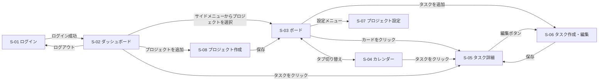
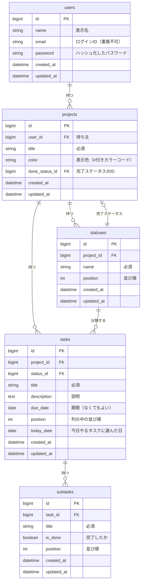

# TaskBoard 要件定義書

## 1. プロジェクト概要

### 1.1 背景
タスクがメモや頭の中に散らばっていると、どこまで進んだか、いつまでにやるべきかがわからなくなる。

### 1.2 目的
タスクの進み具合と期限をひと目で確認できる、Trello風のタスク管理Webアプリ「TaskBoard」を作る。

### 1.3 位置づけ
RaiseTech の課題として作る。要件定義から設計・実装までを一通り経験することも目的に含む。

## 2. 機能要件

| ID | 機能 | 内容 |
|---|---|---|
| F-01 | ログイン・ログアウト | メールアドレスとパスワードでログインする。アカウントは初期データで用意する |
| F-02 | プロジェクト管理 | プロジェクトを複数作成できる。作成・名前と色の変更・削除ができる。必須の入力はタイトルだけ。色は基本カラー（赤・オレンジ・黄・緑・青・紫・ピンク・グレーの8色）から選ぶか、カラーコードで指定する |
| F-03 | ステータス管理 | プロジェクトごとにステータス（列）を持つ。初期値は「未着手 / 進行中 / 確認中 / 完了」。追加・名前変更・並び替え・削除ができる。タスクが残っているステータスと、完了ステータスは削除できない |
| F-04 | タスク管理 | タスクの作成・編集・削除。項目はタイトル（必須）、説明、期限、ステータス |
| F-05 | ステータス変更・並び替え | ボード上でカードをドラッグ＆ドロップして別の列へ移す。同じ列の中でもカードの順番を入れ替えられる |
| F-06 | サブタスク | タスク詳細の中で、追加・完了切り替え・並び替え・文言の修正ができる |
| F-07 | 期限アラート | 期限の3日前〜1日前は黄色、当日と期限超過は赤で表示する。期限超過のときは「期限超過」「見直しをしてください」と表示する。「今日」は朝4時に切り替わる |
| F-08 | ダッシュボード | 左に「今日やるタスク」、右に「タスク一覧」を表示する。タスク一覧には、全プロジェクトの完了以外のタスクを、期限が近い順に表示する。一覧から今日やるタスクへ移せる。完了にしたタスクは、今日やるタスクからすぐ外れる |
| F-09 | カレンダー | 月表示のカレンダーで、期限日の位置にタスクを表示する。完了したタスクはグレーで表示する。表示だけで編集はしない。クリックするとタスク詳細を開く |
| F-10 | タスク詳細 | 表示と編集の画面を分ける |

## 3. 非機能要件

| 分類 | 要件 |
|---|---|
| 対応環境 | PCとスマホのブラウザで使える（画面幅に合わせてレイアウトが変わるレスポンシブ対応） |
| 対応ブラウザ | 最新の Google Chrome |
| 日時 | 日時は日本時間（Asia/Tokyo）で扱う。サーバーの設定に関係なく、日本時間で日付を判断する |
| セキュリティ | パスワードはハッシュ化（暗号化）して保存する |
| セキュリティ | ログインしたユーザーは、自分のデータだけを見たり操作したりできる |
| セキュリティ | チーム機能を入れた場合は、ロールに応じた範囲のデータだけを見られるようにする（8章の拡張） |
| 性能 | 数値目標は設けない。普段の操作で待たされない快適さを目指す（最優先ではない） |
| 公開 | 課題としてインターネットに公開する予定。公開先は7章（技術選定）で決める |

## 4. 画面設計

### 4.1 画面一覧

| ID | 画面 | 主な内容 |
|---|---|---|
| S-01 | ログイン | メールアドレスとパスワードを入力する。アカウントは初期データで用意する |
| S-02 | ダッシュボード | 左に今日やるタスク、右にタスク一覧を表示する。ログイン後に最初に開く画面 |
| S-03 | プロジェクト画面（ボード） | ステータスの列とカード。ドラッグ＆ドロップで移動できる。デフォルトのタブ |
| S-04 | プロジェクト画面（カレンダー） | 月表示で、期限日の位置にタスクを表示する（優先度：中） |
| S-05 | タスク詳細 | タスクの表示と、サブタスクの操作（ダイアログ） |
| S-06 | タスク作成・編集 | タイトル・説明・期限・ステータスの入力と編集（ダイアログ） |
| S-07 | プロジェクト設定 | プロジェクトの名前・色の変更、削除と、ステータスの管理 |
| S-08 | プロジェクト作成 | プロジェクトのタイトルの入力（ダイアログ） |

すべての画面に、サイドメニュー（ダッシュボード / プロジェクト一覧）を共通で置く。スマホでは、サイドメニューをボタンで開閉する。

### 4.2 画面遷移図



### 4.3 画面レイアウト

ワイヤーフレームは、HTML・CSS・JavaScript でモックアップを作るときの元にする。例のデータは、今日を 2026年11月2日として描いている。

共通の決めごと：
- カレンダーのマスやボードのカードのように狭い場所では、長いタイトルを省略して表示する（例：「レポート..」）。タスク詳細では全部表示する
- `[ ]` で囲んだ文字はボタンや入力欄、`【赤】` `【黄】` は期限アラートの色を表す

#### S-01 ログイン

```
+--------------------------------------+
| TaskBoard                            |
|                                      |
| メールアドレス                       |
| [ yamada@example.com            ]    |
| パスワード                           |
| [ ********                      ]    |
|                                      |
| メールアドレスまたはパスワードが     |
| 正しくありません                     |
|                                      |
|                           [ログイン] |
+--------------------------------------+
```

- 画面の中央に表示し、サイドメニューは出さない
- エラーメッセージは、ログインに失敗したときだけ出す（UC-01）

#### S-02 ダッシュボード（PC）

```
+----------------------------------------------------------------------------------+
| TaskBoard                                                              山田 太郎 |
+----------------------+-----------------------------+-----------------------------+
| > ダッシュボード     | 今日やるタスク              | タスク一覧（期限が近い順）  |
|                      |                             |                             |
| プロジェクト         | +-------------------------+ | +-------------------------+ |
|   [青] 課題          | | レポート提出            | | | 資料作成                | |
|   [緑] 家事          | | 課題 / 期限 11/01       | | | 課題 / 期限 11/03       | |
| + プロジェクトを追加 | | 【赤】期限超過          | | | 【黄】期限が近い        | |
|                      | | 見直しをしてください    | | |              [今日やる] | |
|                      | |                  [外す] | | +-------------------------+ |
|                      | +-------------------------+ | +-------------------------+ |
|                      | +-------------------------+ | | 掃除                    | |
|                      | | 買い物                  | | | 家事 / 期限 11/15       | |
|                      | | 家事 / 期限 11/10       | | |              [今日やる] | |
|                      | |                  [外す] | | +-------------------------+ |
|                      | +-------------------------+ | +-------------------------+ |
|                      |                             | | 振り返りを書く          | |
|                      |                             | | 課題 / 期限なし         | |
| ログアウト           |                             | |              [今日やる] | |
|                      |                             | +-------------------------+ |
+----------------------+-----------------------------+-----------------------------+
```

- ヘッダー：左にアプリ名、右にログイン中のユーザー名
- サイドメニュー：「>」は今いる画面。`[青]` はプロジェクトの色。「+ プロジェクトを追加」で S-08 を開く。一番下に「ログアウト」
- 今日やるタスク：カードはドラッグで右の一覧から移せる。「外す」で一覧に戻す
- タスク一覧：全プロジェクトの完了以外のタスクを、期限が近い順に並べる。「今日やる」ボタンでも左へ移せる
- カード：タイトル、プロジェクト名、期限、期限アラート（【黄】は3日前〜1日前、【赤】は当日と期限超過）。期限超過のときは「見直しをしてください」も出す。クリックで S-05 を開く

#### S-02 ダッシュボード（スマホ）

```
+------------------------------------+
| [メニュー]  TaskBoard              |
+------------------------------------+
| 今日やるタスク                     |
| +--------------------------------+ |
| | レポート提出                   | |
| | 課題 / 期限 11/01              | |
| | 【赤】期限超過                 | |
| | 見直しをしてください           | |
| |                         [外す] | |
| +--------------------------------+ |
|                                    |
| タスク一覧（期限が近い順）         |
| +--------------------------------+ |
| | 資料作成                       | |
| | 課題 / 期限 11/03              | |
| | 【黄】期限が近い               | |
| |                     [今日やる] | |
| +--------------------------------+ |
| +--------------------------------+ |
| | 掃除                           | |
| | 家事 / 期限 11/15              | |
| |                     [今日やる] | |
| +--------------------------------+ |
+------------------------------------+
```

- 「メニュー」で、サイドメニューを開閉する
- 今日やるタスクとタスク一覧を、縦に並べる。移すときはドラッグではなくボタン（「今日やる」「外す」）を使う

#### S-03 ボード（PC）

```
+--------------------------------------------------------------------------------------------------+
| TaskBoard                                                                              山田 太郎 |
+----------------------+---------------------------------------------------------------------------+
|   ダッシュボード     | 課題                                                               [設定] |
|                      | [ボード]  カレンダー                                                      |
| プロジェクト         |                                                                           |
| > [青] 課題          | [+ タスクを追加]                                                          |
|   [緑] 家事          |                                                                           |
| + プロジェクトを追加 |                                                                           |
|                      +------------------+------------------+------------------+------------------+
|                      | 未着手 (2)       | 進行中 (1)       | 確認中 (0)       | 完了 (1)         |
|                      |                  |                  |                  |                  |
|                      | +--------------+ | +--------------+ |                  | +--------------+ |
|                      | | 資料作成     | | | レポート提出 | |                  | | 参考書を買う | |
|                      | | 【黄】11/03  | | | 【赤】11/01  | |                  | | 11/02        | |
|                      | +--------------+ | | 期限超過     | |                  | +--------------+ |
|                      | +--------------+ | +--------------+ |                  |                  |
| ログアウト           | | 振り返り     | |                  |                  |                  |
|                      | | 期限なし     | |                  |                  |                  |
|                      | +--------------+ |                  |                  |                  |
+----------------------+------------------+------------------+------------------+------------------+
```

- 上部：プロジェクト名と「設定」（S-07 を開く）。タブは「ボード」と「カレンダー」で、`[ ]` が選択中
- 「+ タスクを追加」で、S-06 を作成モードで開く
- 列：ステータスごとに並べ、カッコ内はタスクの数。列が多いときは横スクロール
- カード：タイトルと期限（アラートの色つき）。ドラッグ＆ドロップで、別の列へ移したり同じ列の中で並べ替えたりできる。完了の列のカードにはアラートを出さない

#### S-03 ボード（スマホ）

```
+------------------------------------+
| [メニュー]  課題            [設定] |
+------------------------------------+
| [ボード]  カレンダー               |
|                                    |
| < [未着手] 進行中  確認中  完了 >  |
|                                    |
| +--------------------------------+ |
| | 資料作成                       | |
| | 【黄】期限 11/03               | |
| +--------------------------------+ |
| +--------------------------------+ |
| | 振り返り                       | |
| | 期限なし                       | |
| +--------------------------------+ |
|                                    |
|                   [+ タスクを追加] |
+------------------------------------+
```

- 列は1つずつ表示し、上の切り替えで別のステータスに移る
- スマホではドラッグせず、S-06 の編集でステータスを変える（UC-12）

#### S-04 カレンダー（PC）

```
+------------------------------------------------------------------------------------------+
| 課題                                                                              [設定] |
| ボード  [カレンダー]                                                                     |
|                                                                                          |
| [<]  2026年11月  [>]                                                              [今月] |
+------------+------------+------------+------------+------------+------------+------------+
| 日         | 月         | 火         | 水         | 木         | 金         | 土         |
+------------+------------+------------+------------+------------+------------+------------+
| 1          | 2          | 3          | 4          | 5          | 6          | 7          |
| 【赤】     | (完了)     | 【黄】     |            |            |            |            |
| レポート.. | 参考書..   | 資料作成   |            |            |            |            |
+------------+------------+------------+------------+------------+------------+------------+
| 8          | 9          | 10         | 11         | 12         | 13         | 14         |
|            |            |            |            |            |            |            |
|            |            |            |            |            |            |            |
+------------+------------+------------+------------+------------+------------+------------+
| 15         | 16         | 17         | 18         | 19         | 20         | 21         |
|            |            |            |            |            |            |            |
|            |            |            |            |            |            |            |
+------------+------------+------------+------------+------------+------------+------------+
| 22         | 23         | 24         | 25         | 26         | 27         | 28         |
|            |            |            |            |            |            |            |
|            |            |            |            |            |            |            |
+------------+------------+------------+------------+------------+------------+------------+
| 29         | 30         |            |            |            |            |            |
|            |            |            |            |            |            |            |
|            |            |            |            |            |            |            |
+------------+------------+------------+------------+------------+------------+------------+
```

- ヘッダーとサイドメニューは、ボードと同じ（図では省略）
- 「<」「>」で前の月と次の月に切り替え、「今月」で今月に戻る
- 期限の日にタスクを表示する。アラートの色はボードと同じで、完了したタスクはグレー（図の「(完了)」）
- 期限のないタスクは表示しない。タスクをクリックすると S-05 を開く

#### S-04 カレンダー（スマホ）

```
+-----------------------------------------+
| [メニュー]  課題                 [設定] |
+-----------------------------------------+
| ボード  [カレンダー]                    |
| [<] 2026年11月 [>]               [今月] |
+-----+-----+-----+-----+-----+-----+-----+
| 日  | 月  | 火  | 水  | 木  | 金  | 土  |
+-----+-----+-----+-----+-----+-----+-----+
| 1   | *2* | 3   | 4   | 5   | 6   | 7   |
| 赤  | 灰  | 黄  |     |     |     |     |
| 8   | 9   | 10  | 11  | 12  | 13  | 14  |
|     |     |     |     |     |     |     |
| 15  | 16  | 17  | 18  | 19  | 20  | 21  |
|     |     |     |     |     |     |     |
| 22  | 23  | 24  | 25  | 26  | 27  | 28  |
|     |     |     |     |     |     |     |
| 29  | 30  |     |     |     |     |     |
|     |     |     |     |     |     |     |
+-----+-----+-----+-----+-----+-----+-----+
| 11月2日（月）のタスク                   |
| +-------------------------------------+ |
| | 参考書を買う                        | |
| | (完了)                              | |
| +-------------------------------------+ |
+-----------------------------------------+
```

- マスにはタスクの名前を出さず、色の印だけを出す（赤・黄はアラートの色、灰は完了）
- 日付を押すと「*2*」のように選択中になり、その日のタスクが下に一覧で出る。タスクを押すと S-05 を開く
- 初めて開いたときは、今日の日付が選ばれた状態になる

#### S-05 タスク詳細（ダイアログ）

```
+------------------------------------------------+
| レポート提出                               [x] |
| 課題 / 進行中                                  |
| 期限 11/01  【赤】期限超過                     |
|             見直しをしてください               |
+------------------------------------------------+
| 説明                                           |
| 第3回課題のレポートを提出する。                |
|                                                |
| サブタスク (1/3)                               |
| = [x] 資料を集める                      [削除] |
| = [ ] 下書きを書く                      [削除] |
| = [ ] 見直す                            [削除] |
| [ サブタスクを入力          ]           [追加] |
+------------------------------------------------+
| [削除]                                  [編集] |
+------------------------------------------------+
```

- 上部：タイトル、プロジェクト名、ステータス、期限とアラート
- サブタスク：「=」はドラッグで並べ替えるためのつまみ。`[x]` は完了。文言はクリックするとその場で書き直せる。「(1/3)」は完了した数と全体の数
- 「編集」で S-06 を開く。「削除」は確認してから消す（UC-11）

#### S-06 タスク作成・編集（ダイアログ）

```
+------------------------------------------------+
| タスクを編集                               [x] |
+------------------------------------------------+
| タイトル（必須・50文字まで）                   |
| [ レポート提出                         ]       |
| タイトルを入力してください                     |
|                                                |
| 説明（1000文字まで）                           |
| [ 第3回課題のレポートを提出する。      ]       |
| [                                      ]       |
| [                                      ]       |
|                                                |
| 期限                                           |
| [ 2026/11/01  v ]  [期限なし]                  |
|                                                |
| ステータス                                     |
| [ 進行中      v ]                              |
+------------------------------------------------+
|                           [キャンセル]  [保存] |
+------------------------------------------------+
```

- 作成のときは、見出しが「タスクを追加」で、入力欄は空。ステータスの初期値は「未着手」
- 「タイトルを入力してください」は、タイトルが空のまま保存したときだけ出す
- 期限はカレンダーから選び、「期限なし」で空にできる

#### S-07 プロジェクト設定（ダイアログ）

```
+------------------------------------------------+
| プロジェクト設定                           [x] |
+------------------------------------------------+
| プロジェクト名（必須・30文字まで）             |
| [ 課題                       ]                 |
|                                                |
| 色                                             |
| [赤] [橙] [黄] [緑] [*青*] [紫] [桃] [灰]      |
| カラーコード [ #3B82F6 ]                       |
+------------------------------------------------+
| ステータス                                     |
| = [ 未着手   ]                          [削除] |
| = [ 進行中   ]                          [削除] |
| = [ 確認中   ]                          [削除] |
| = [ 完了     ]  完了ステータス                 |
| [+ ステータスを追加]                           |
+------------------------------------------------+
| [プロジェクトを削除]      [キャンセル]  [保存] |
+------------------------------------------------+
```

- 色：`*` は選んでいる色。基本カラーを選ぶと、カラーコードの欄にその値が入る
- ステータス：名前はその場で書き換えられる。「=」をドラッグして並べ替える。完了ステータスには削除ボタンを出さない
- 「プロジェクトを削除」は、確認してから消す（UC-05）

#### S-08 プロジェクト作成（ダイアログ）

```
+------------------------------------------+
| プロジェクトを追加                   [x] |
+------------------------------------------+
| タイトル（必須・30文字まで）             |
| [                            ]           |
|                                          |
| 色は自動で設定されます。                 |
| あとから設定画面で変更できます。         |
+------------------------------------------+
|                     [キャンセル]  [作成] |
+------------------------------------------+
```

- 「作成」を押すと、4つの初期ステータスもできて、そのプロジェクトのボードを開く（UC-03）

## 5. ユースケース

アクターは「ユーザー」（ログインした利用者）の1種類とする。

### 5.1 ユースケース一覧

| ID | ユースケース | 関連する機能 |
|---|---|---|
| UC-01 | ログインする | F-01 |
| UC-02 | ログアウトする | F-01 |
| UC-03 | プロジェクトを作成する | F-02 |
| UC-04 | プロジェクトの名前・色を変更する | F-02 |
| UC-05 | プロジェクトを削除する | F-02 |
| UC-06 | ステータスを追加する | F-03 |
| UC-07 | ステータスを編集・並び替える | F-03 |
| UC-08 | ステータスを削除する | F-03 |
| UC-09 | タスクを作成する | F-04 |
| UC-10 | タスクを編集する | F-04, F-10 |
| UC-11 | タスクを削除する | F-04 |
| UC-12 | タスクのステータス・並び順を変更する | F-05 |
| UC-13 | サブタスクを追加する | F-06 |
| UC-14 | サブタスクを完了にする | F-06 |
| UC-15 | サブタスクを並び替える | F-06 |
| UC-16 | サブタスクを編集する | F-06 |
| UC-17 | サブタスクを削除する | F-06 |
| UC-18 | 期限アラートを確認する | F-07 |
| UC-19 | 今日やるタスクを選ぶ | F-08 |
| UC-20 | 今日やるタスクから外す | F-08 |
| UC-21 | カレンダーで期限を確認する | F-09 |

### 5.2 ユースケース詳細

#### UC-01 ログインする
- **アクター:** ユーザー
- **前提条件:** ログインしていない。アカウントが初期データで用意されている
- **基本フロー:**
    1. ユーザーが、ログイン画面でメールアドレスとパスワードを入力し、「ログイン」ボタンを押す
    2. システムが、入力内容を確認する
    3. システムが、ダッシュボードを表示する
- **代替・例外フロー:**
    - メールアドレスかパスワードが空のときは、入力を促すメッセージを表示する
    - メールアドレスかパスワードが間違っているときは、「メールアドレスまたはパスワードが正しくありません」と表示する
- **事後条件:** ログインした状態でダッシュボードが表示されている

#### UC-02 ログアウトする
- **アクター:** ユーザー
- **前提条件:** ログインしている
- **基本フロー:**
    1. ユーザーが、サイドメニューの「ログアウト」を押す
    2. システムが、ログイン状態を解除する
    3. システムが、ログイン画面を表示する
- **代替・例外フロー:** なし
- **事後条件:** ログアウトした状態で、ログイン画面が表示されている

#### UC-03 プロジェクトを作成する
- **アクター:** ユーザー
- **前提条件:** ログインしている
- **基本フロー:**
    1. ユーザーが、サイドメニューの「プロジェクトを追加」を押す
    2. システムが、プロジェクト作成ダイアログを表示する
    3. ユーザーが、タイトルを入力して保存する
    4. システムが、プロジェクトを保存し、初期ステータス「未着手 / 進行中 / 確認中 / 完了」を作る
    5. システムが、サイドメニューにプロジェクトを追加し、そのボード画面を表示する
- **代替・例外フロー:**
    - タイトルが空のときは、「タイトルを入力してください」と表示して保存しない
    - キャンセルしたときは、何も保存せずにダイアログを閉じる
- **事後条件:** 新しいプロジェクトがサイドメニューに表示され、4つの初期ステータスを持っている

#### UC-04 プロジェクトの名前・色を変更する
- **アクター:** ユーザー
- **前提条件:** プロジェクト設定画面を開いている
- **基本フロー:**
    1. ユーザーが、プロジェクト名を変える、または色を基本カラーから選ぶかカラーコードで指定して、保存する
    2. システムが、変更を保存する
    3. システムが、サイドメニューとプロジェクト画面の表示を変更後の名前と色に変える
- **代替・例外フロー:**
    - プロジェクト名が空のときは、エラーを表示して保存しない
    - カラーコードの形式が正しくないとき（例：`#` がない、桁が足りない）は、エラーを表示して保存しない
- **事後条件:** 変更後の名前と色が表示されている

#### UC-05 プロジェクトを削除する
- **アクター:** ユーザー
- **前提条件:** プロジェクト設定画面を開いている
- **基本フロー:**
    1. ユーザーが、「プロジェクトを削除」ボタンを押す
    2. システムが、「プロジェクトと、その中のタスクがすべて削除されます。よろしいですか？」と確認する
    3. ユーザーが、「削除」を押す
    4. システムが、プロジェクトと、その中のステータス・タスク・サブタスクを削除する
    5. システムが、ダッシュボードを表示する
- **代替・例外フロー:**
    - 確認で「キャンセル」を押したときは、削除しない
- **事後条件:** プロジェクトがサイドメニューから消えている

#### UC-06 ステータスを追加する
- **アクター:** ユーザー
- **前提条件:** プロジェクト設定画面を開いている
- **基本フロー:**
    1. ユーザーが、「ステータスを追加」を押し、ステータス名を入力して保存する
    2. システムが、ステータスを一番後ろに追加して保存する
    3. ボードに、新しい列が表示される
- **代替・例外フロー:**
    - ステータス名が空のときは、エラーを表示して保存しない
- **事後条件:** ボードに新しいステータスの列が表示されている

#### UC-07 ステータスを編集・並び替える
- **アクター:** ユーザー
- **前提条件:** プロジェクト設定画面を開いている
- **基本フロー:**
    1. ユーザーが、ステータス名を変える、または並び順を変えて保存する
    2. システムが、変更を保存する
    3. ボードの列の名前と順番が、変更後のものになる
- **代替・例外フロー:**
    - ステータス名が空のときは、エラーを表示して保存しない
- **事後条件:** ボードに、変更後の名前と順番で列が表示されている

#### UC-08 ステータスを削除する
- **アクター:** ユーザー
- **前提条件:** プロジェクト設定画面を開いている
- **基本フロー:**
    1. ユーザーが、ステータスの「削除」を押す
    2. システムが、「このステータスを削除しますか？」と確認する
    3. ユーザーが「削除」を押す
    4. システムが、ステータスを削除する
- **代替・例外フロー:**
    - ステータスにタスクが残っているときは、「タスクが残っているため削除できません」と表示して削除しない
    - 完了ステータスは削除できない（削除ボタンを表示しない）
    - 確認で「キャンセル」を押したときは、削除しない
- **事後条件:** ボードからその列が消えている

#### UC-09 タスクを作成する
- **アクター:** ユーザー
- **前提条件:** ログインしていて、プロジェクトのボード画面を開いている
- **基本フロー:**
    1. ユーザーが、「タスクを追加」ボタンを押す
    2. システムが、タスク作成ダイアログを表示する
    3. ユーザーが、タイトル（必須）、説明、期限、ステータスを入力して保存する
    4. システムが、タスクを保存し、ボードの該当する列にカードを表示する
- **代替・例外フロー:**
    - タイトルが空のときは、「タイトルを入力してください」と表示して保存しない
    - キャンセルしたときは、何も保存せずにダイアログを閉じる
- **事後条件:** 新しいタスクがボードに表示されている

#### UC-10 タスクを編集する
- **アクター:** ユーザー
- **前提条件:** タスク詳細を開いている
- **基本フロー:**
    1. ユーザーが、「編集」ボタンを押す
    2. システムが、いまの内容が入った編集ダイアログを表示する
    3. ユーザーが、内容を変えて保存する
    4. システムが、変更を保存し、タスク詳細に戻る
- **代替・例外フロー:**
    - タイトルを空にしたときは、エラーを表示して保存しない
    - キャンセルしたときは、変更を保存せずにタスク詳細へ戻る
- **事後条件:** 変更した内容がボードとタスク詳細に表示されている

#### UC-11 タスクを削除する
- **アクター:** ユーザー
- **前提条件:** タスク詳細を開いている
- **基本フロー:**
    1. ユーザーが、「削除」ボタンを押す
    2. システムが、「このタスクを削除しますか？」と確認する
    3. ユーザーが「削除」を押す
    4. システムが、タスクとそのサブタスクを削除し、ダイアログを閉じる
- **代替・例外フロー:**
    - 確認で「キャンセル」を押したときは、削除しない
- **事後条件:** ボード・ダッシュボード・カレンダーからタスクが消えている

#### UC-12 タスクのステータス・並び順を変更する
- **アクター:** ユーザー
- **前提条件:** プロジェクトのボード画面を開いている
- **基本フロー:**
    1. ユーザーが、カードを別のステータスの列、または同じ列の別の位置へドラッグ＆ドロップする
    2. システムが、タスクのステータスと並び順を更新して保存する
    3. カードが、移した先の列と位置に表示される
- **代替・例外フロー:**
    - 保存に失敗したときは、カードを元の列と位置に戻してエラーを表示する
    - スマホではドラッグしにくいため、タスク編集からステータスを変えることもできる
    - 完了ステータスへ移したタスクは、今日やるタスクからすぐ外れる
- **事後条件:** タスクが新しい列と位置に表示されている

#### UC-13 サブタスクを追加する
- **アクター:** ユーザー
- **前提条件:** タスク詳細を開いている
- **基本フロー:**
    1. ユーザーが、サブタスクの入力欄に内容を入力し、追加する
    2. システムが、サブタスクを一番下に追加して保存する
- **代替・例外フロー:**
    - 内容が空のときは、追加しない
- **事後条件:** タスク詳細に新しいサブタスクが表示されている

#### UC-14 サブタスクを完了にする
- **アクター:** ユーザー
- **前提条件:** タスク詳細を開いていて、サブタスクがある
- **基本フロー:**
    1. ユーザーが、サブタスクのチェックボックスを押す
    2. システムが、サブタスクの完了・未完了を切り替えて保存する
- **代替・例外フロー:**
    - 完了済みのサブタスクをもう一度押したときは、未完了に戻す
- **事後条件:** サブタスクの完了状態が切り替わっている

#### UC-15 サブタスクを並び替える
- **アクター:** ユーザー
- **前提条件:** タスク詳細を開いていて、サブタスクが2つ以上ある
- **基本フロー:**
    1. ユーザーが、サブタスクをドラッグして順番を変える
    2. システムが、新しい並び順を保存する
- **代替・例外フロー:**
    - 保存に失敗したときは、元の順番に戻してエラーを表示する
- **事後条件:** サブタスクが新しい順番で表示されている

#### UC-16 サブタスクを編集する
- **アクター:** ユーザー
- **前提条件:** タスク詳細を開いていて、サブタスクがある
- **基本フロー:**
    1. ユーザーが、サブタスクの文言をクリックして書き直す
    2. システムが、変更を保存する
- **代替・例外フロー:**
    - 文言を空にしたときは、保存せずに元の文言に戻す
- **事後条件:** 書き直した文言が表示されている

#### UC-17 サブタスクを削除する
- **アクター:** ユーザー
- **前提条件:** タスク詳細を開いていて、サブタスクがある
- **基本フロー:**
    1. ユーザーが、サブタスクの「削除」を押す
    2. システムが、サブタスクを削除する
- **代替・例外フロー:** なし
- **事後条件:** タスク詳細からサブタスクが消えている

#### UC-18 期限アラートを確認する
- **アクター:** ユーザー
- **前提条件:** ログインしていて、期限が設定されたタスクがある
- **基本フロー:**
    1. ユーザーが、ダッシュボードまたはボードを開く
    2. システムが、今日の日付（日本時間。朝4時に切り替わる）と各タスクの期限を比べる
    3. システムが、期限の3日前〜1日前のタスクを黄色、当日と期限超過のタスクを赤で表示する
    4. システムが、期限超過のタスクに「期限超過」「見直しをしてください」と表示する
- **代替・例外フロー:**
    - 完了ステータスのタスクには、アラートを表示しない
    - 期限が設定されていないタスクには、アラートを表示しない
- **事後条件:** 期限が近いタスクと過ぎたタスクが、色で見分けられる

#### UC-19 今日やるタスクを選ぶ
- **アクター:** ユーザー
- **前提条件:** ダッシュボードを開いている
- **基本フロー:**
    1. ユーザーが、右側のタスク一覧から、左側の「今日やるタスク」へタスクを移す
    2. システムが、そのタスクを今日やるタスクとして保存する
- **代替・例外フロー:**
    - スマホでは、タスクの「今日やる」ボタンでも移せる
    - 朝4時を過ぎて日付が変わると、前の日に選んだタスクは自動で今日やるタスクから外れる
    - タスクを完了にすると、今日やるタスクからすぐ外れる
- **事後条件:** タスクが「今日やるタスク」に表示されている

#### UC-20 今日やるタスクから外す
- **アクター:** ユーザー
- **前提条件:** ダッシュボードの「今日やるタスク」にタスクがある
- **基本フロー:**
    1. ユーザーが、タスクの「外す」ボタンを押す
    2. システムが、今日やるタスクから外して保存する
- **代替・例外フロー:** なし
- **事後条件:** タスクが「今日やるタスク」から消え、タスク一覧に表示されている

#### UC-21 カレンダーで期限を確認する
- **アクター:** ユーザー
- **前提条件:** プロジェクト画面を開いている
- **基本フロー:**
    1. ユーザーが、「カレンダー」タブを押す
    2. システムが、今月のカレンダーを表示し、期限日の位置にタスクを表示する
    3. ユーザーが、前の月・次の月へ切り替える
    4. ユーザーがタスクをクリックすると、システムがタスク詳細を表示する
- **代替・例外フロー:**
    - 期限が設定されていないタスクは、カレンダーに表示しない
    - 完了したタスクは、グレーで表示する
- **事後条件:** 期限ごとのタスクの並びを確認できる

## 6. データ設計

### 6.1 ER図



### 6.2 データの決めごと

| 対象 | 決めごと |
|---|---|
| 完了ステータス | プロジェクトを作ると、ステータスを4つ（未着手 / 進行中 / 確認中 / 完了）自動で作る。「完了」のIDを `projects.done_status_id` に記録する |
| 完了ステータス | `projects.done_status_id` は、プロジェクトを作った時点ではまだ空にしておき、4つのステータスを作った直後に「完了」のIDを記録する |
| 完了ステータス | 完了かどうかはIDで判断するので、名前を変えても影響しない。完了ステータスは削除できない |
| 整合性 | タスクのステータスは、同じプロジェクトのステータスに限る。保存するときにアプリ側で確認し、さらにデータベースでも `project_id` と `status_id` のセットで確認する（複合外部キー） |
| 日付の区切り | 日時は日本時間（Asia/Tokyo）で扱う。「今日」は朝4時に切り替わる（0時〜3時59分は前の日として扱う）。今日やるタスクと期限アラートの両方で、この区切りを使う |
| 今日やるタスク | 選んだ日を `tasks.today_date` に記録する。その日付が「今日」と同じタスクだけを、今日やるタスクとして表示する。日付が変わると、自動で外れる |
| 今日やるタスク | 完了ステータスのタスクは、`today_date` が今日でも、今日やるタスクに表示しない |
| プロジェクトの色 | 基本カラー（赤・オレンジ・黄・緑・青・紫・ピンク・グレーの8色）から選ぶか、#付きのカラーコード（例：`#3B82F6`）で指定する。作成時は基本カラーの1つが自動で設定される |
| 削除 | プロジェクトを削除すると、その中のステータス・タスク・サブタスクもまとめて削除する。タスクを削除すると、そのサブタスクもまとめて削除する |
| データの範囲 | ユーザーは、自分の `user_id` を持つプロジェクトと、その中のデータだけを扱える |

### 6.3 テーブル定義

型は MySQL を想定して書く。PostgreSQL に決まった場合は、自動採番を `GENERATED ALWAYS AS IDENTITY`、`DATETIME` を `TIMESTAMP` に読み替える。削除したときの動き（6.2）を、データベースの連鎖削除で実現するかアプリで実現するかは、設計で決める。

#### users（ユーザー）

| カラム | 型 | 必須 | 初期値 | 制約・説明 |
|---|---|---|---|---|
| id | BIGINT | ○ | 自動採番 | 主キー |
| name | VARCHAR(20) | ○ | | 表示名 |
| email | VARCHAR(255) | ○ | | ログインID。重複不可 |
| password | VARCHAR(255) | ○ | | ハッシュ化したパスワード |
| created_at | DATETIME | ○ | 現在日時 | |
| updated_at | DATETIME | ○ | 現在日時 | 更新時に自動で変わる |

#### projects（プロジェクト）

| カラム | 型 | 必須 | 初期値 | 制約・説明 |
|---|---|---|---|---|
| id | BIGINT | ○ | 自動採番 | 主キー |
| user_id | BIGINT | ○ | | 外部キー → users.id。持ち主 |
| title | VARCHAR(30) | ○ | | |
| color | CHAR(7) | ○ | 基本カラーの1つ | `#` ＋ 16進数6桁 |
| done_status_id | BIGINT | | なし（空） | 外部キー → statuses.id。ステータスを作った直後に記録する |
| created_at | DATETIME | ○ | 現在日時 | |
| updated_at | DATETIME | ○ | 現在日時 | 更新時に自動で変わる |

#### statuses（ステータス）

| カラム | 型 | 必須 | 初期値 | 制約・説明 |
|---|---|---|---|---|
| id | BIGINT | ○ | 自動採番 | 主キー |
| project_id | BIGINT | ○ | | 外部キー → projects.id |
| name | VARCHAR(20) | ○ | | |
| position | INT | ○ | | 並び順 |
| created_at | DATETIME | ○ | 現在日時 | |
| updated_at | DATETIME | ○ | 現在日時 | 更新時に自動で変わる |

制約：（project_id, id）の組を一意にする（tasks の複合外部キーで使う）

#### tasks（タスク）

| カラム | 型 | 必須 | 初期値 | 制約・説明 |
|---|---|---|---|---|
| id | BIGINT | ○ | 自動採番 | 主キー |
| project_id | BIGINT | ○ | | 外部キー → projects.id |
| status_id | BIGINT | ○ | | （project_id, status_id）で statuses（project_id, id）を参照する複合外部キー |
| title | VARCHAR(50) | ○ | | |
| description | VARCHAR(1000) | | なし | 説明 |
| due_date | DATE | | なし | 期限 |
| position | INT | ○ | | 列の中の並び順 |
| today_date | DATE | | なし | 今日やるタスクに選んだ日 |
| created_at | DATETIME | ○ | 現在日時 | |
| updated_at | DATETIME | ○ | 現在日時 | 更新時に自動で変わる |

#### subtasks（サブタスク）

| カラム | 型 | 必須 | 初期値 | 制約・説明 |
|---|---|---|---|---|
| id | BIGINT | ○ | 自動採番 | 主キー |
| task_id | BIGINT | ○ | | 外部キー → tasks.id |
| title | VARCHAR(50) | ○ | | |
| is_done | BOOLEAN | ○ | false | 完了したか |
| position | INT | ○ | | 並び順 |
| created_at | DATETIME | ○ | 現在日時 | |
| updated_at | DATETIME | ○ | 現在日時 | 更新時に自動で変わる |

## 7. 技術選定

技術は、要件が確定してから決める。下の表は、現時点の候補である。

| 分類 | 候補 | 状態 | 理由 |
|---|---|---|---|
| バックエンド | Java / Spring Boot | 講座の指定 | RaiseTech の課題の指定 |
| フロントエンド | React（TypeScript） | 採用予定 | ドラッグ＆ドロップの多い画面が作りやすい。React の経験が活かせる |
| 画面とサーバーのつなぎ方 | Spring Boot の REST API | 候補 | React と組み合わせるため |
| ビルドツール | Vite | 候補 | React の開発環境を手早く用意できる |
| データベース | MySQL | 候補 | Spring Boot と組み合わせる例が多く、AWS の RDS でも使える |
| O/Rマッパー | MyBatis | 候補 | SQL を自分で書くので、データベースの理解が深まる |
| ドラッグ＆ドロップ | @hello-pangea/dnd | 候補 | team-task-manager で使った経験がある |
| カレンダー | FullCalendar | 候補 | 月表示のカレンダーを少ない実装で作れる |
| 公開先 | AWS（EC2 ＋ RDS） | 候補 | 課題の公開先として一般的で、インフラの経験も積める |

## 8. 将来の拡張候補

- ユーザー登録
- チーム機能（プロジェクトへの招待、メンバー管理）
- プロジェクトロール（MANAGER / LEADER / MEMBER）
- 担当者の設定
- 通知（画面上部の通知欄で、招待・メンション・期限接近などを知らせる）
- メッセージ（プロジェクト内のやり取り。@メンションすると相手に通知が届く）
- タスクの依存関係
- ガントチャート
- Googleカレンダー連携
- AIサポート（タスク分解、抜け漏れ補助）
- タスク完了時のお祝い表示
- 「今日」の切り替え時刻をユーザーが設定する（初期値は朝4時）
- 削除したデータを30日間残し、その間は元に戻せるようにする（論理削除とゴミ箱）

## 9. 制約事項

- フロントエンド＋バックエンド＋データベースの3層構成で開発する
- スクールの課題として開発する
- ログイン機能ありで開発する。ただし、提出の条件でログインなしを求められた場合は、ログイン機能を外す可能性がある（確認用のアカウントを初期データで用意し、ログイン情報を README に書く）
